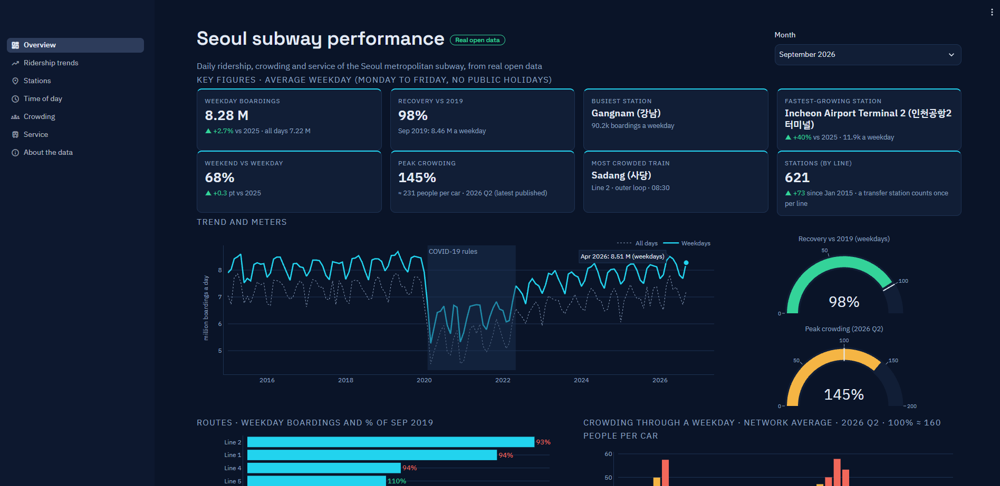

# Seoul subway performance

An interactive KPI dashboard of the Seoul metropolitan subway, built in Python with Streamlit from **real open data**: daily ridership for every line and station from 2015 to 2026, hourly gate counts, crowding by half hour and Seoul Metro's operating figures. Nothing is simulated.

**Live app:** https://seoulsubway.streamlit.app



## What the dashboard shows

| Page | What you can explore |
|---|---|
| Overview | A one-screen KPI dashboard for any month since 2015: weekday boardings, recovery against 2019, busiest and fastest-growing stations, weekend share, peak crowding and network size |
| Ridership trends | Daily, weekly and monthly boardings by route and operator, weekdays against weekends, change by route and a calendar of every day |
| Stations | Busiest stations, biggest gainers and losers since 2019, new stations and the history of any station |
| Time of day | The daily rhythm of the network, "home" and "work" stations from morning taps, and the hourly profile of any station |
| Crowding | Where and when trains are full (heatmap by station and half hour), peak crowding by line over time, the most crowded trains and weekend hot spots |
| Service | Seoul Metro's lines, headways, trips and fleet, boardings per train-km, and peak capacity against crowding |
| About the data | Sources, definitions, how the data was prepared and every data issue found |

## Some findings

- **Ridership has almost recovered.** In September 2026 an average weekday carried 8.28 million boardings, 98% of September 2019.
- **Compare weekdays, not months.** Chuseok fell in September 2026 but in October 2025, so the all-days average for September fell while weekday ridership rose 2.7%.
- **Growth came from new stations.** Lines 5 and 8 grew because they were extended; at the same stations, most core lines are still a few percent below 2019.
- **Line 8 is the surprise in crowding.** It runs short 6-car trains every 4.5 minutes, a third of Line 2's peak capacity, and reaches 145%, as crowded as the busiest lines.
- **The city's rhythm:** the evening peak (18:00) is the busiest hour; weekends have no morning peak and carry about two thirds of a weekday.

## Data and honesty

All data is published by the Seoul Metropolitan Government and Seoul Metro on [Seoul Open Data Plaza](https://data.seoul.go.kr) and the [Korean Public Data Portal](https://www.data.go.kr). Checking it revealed several problems, which are handled in the notebooks and explained on the About the data page, for example:

- Seoul Metro's hourly file has a 13:00 hour about ten times too high on every day of April 2024, so April is left out.
- When a new line opens at a station, the card data books part of its passengers to the new line; station comparisons therefore use whole stations whose lines did not change.
- Stations that join or leave the data are excluded from like-for-like comparisons.

This is an independent portfolio project and is not affiliated with Seoul Metro, KORAIL or the Seoul Metropolitan Government.

## How it was made

| Step | File | What it does |
|---|---|---|
| 0 | `00datacheck.ipynb` | Opens every raw file and profiles columns, encodings and coverage |
| 0 | `00download.ipynb` | Fetches the latest months from the Seoul Open API (needs a free API key) |
| 1 | `01clean.ipynb` | Repairs and joins the raw files into tidy tables, with one lookup for lines and stations |
| 2 | `02dashdata.ipynb` | Builds the small summary files in `data/app` that the app reads |
| App | `streamlit_app.py`, `app/` | Seven pages; settings in `app/settings.py`, theme and fonts in `.streamlit/config.toml` |

The raw and clean data (about 200 MB) are not stored here; the notebooks rebuild them from the public sources.

## Run it on your own computer

```
uv venv --python 3.12
uv pip install -r requirements.txt
streamlit run streamlit_app.py
```

Built with Python, pandas, Plotly and Streamlit by Lik Ren Tai.
